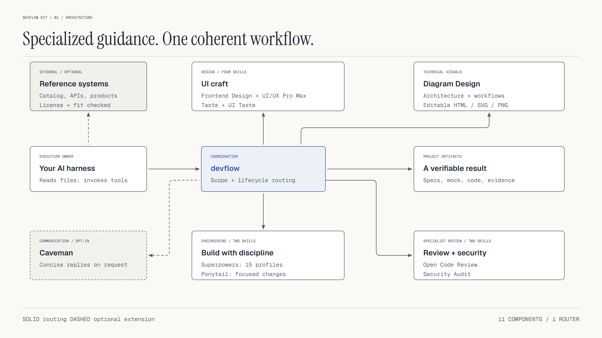
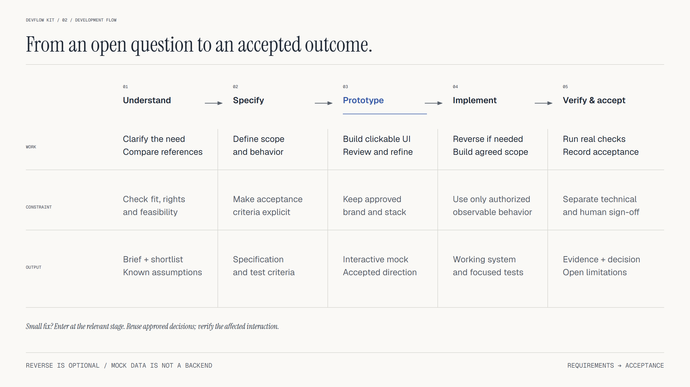
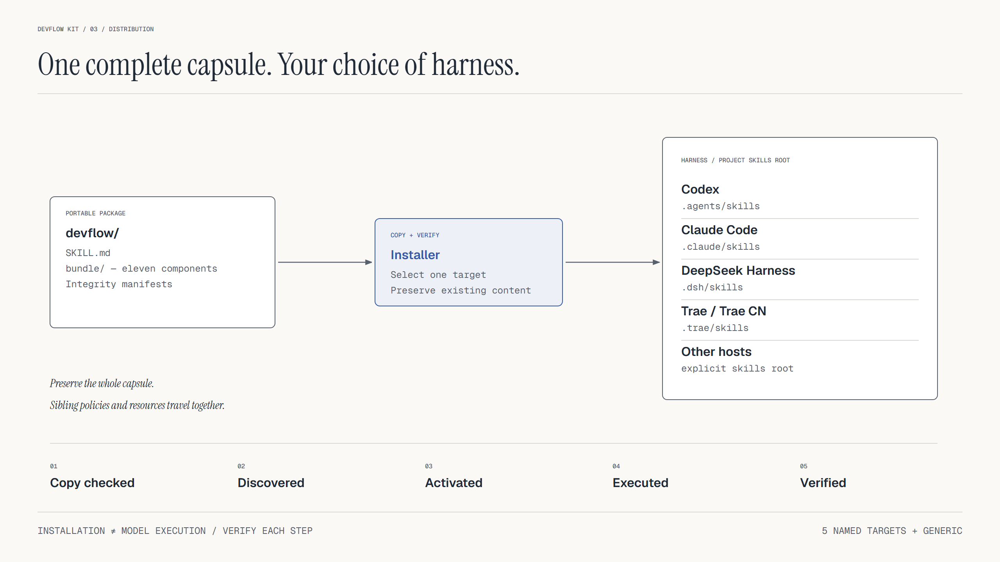

# DevFlow Kit

**From intent to verified software.**


[Get started](#quick-start) · [Architecture](#how-it-fits-together) · [Workflow](#the-development-workflow) · [Skills](#eleven-complementary-skills) · [Verification](#verify-and-package)

DevFlow Kit brings **eleven complementary skills** into a practical workflow for coding agents. Clarify the problem, research reference systems, write specifications, visualize architecture, build an interactive mock, implement the system and verify the outcome.

Use the complete workflow for a new product, or enter at the relevant stage for an existing project. The router carries approved decisions forward and loads the guidance needed for the current task.

**v0.9.0** · Portable Agent Skills · Codex / Claude Code / DeepSeek Harness / Trae · Python installer

## Quick start

Install Python 3.12+, clone this repository, and choose the project where your agent will work:

```bash
git clone https://github.com/chinhkrb113/devflow-kit.git
cd devflow-kit
python plugin/install.py --target codex --project "/path/to/project"
python plugin/install.py --target codex --project "/path/to/project" --check
```

Replace the example path with an existing project directory. On Windows, a path such as `D:/my-project` works. Start a fresh agent session and invoke `$devflow` in Codex, or the name/command exposed by your harness.

```text
$devflow Build a task management tool for a small team.
Clarify requirements, compare reference systems, write the specification
and acceptance criteria, draw the architecture, then create an interactive
mock to agree on behavior before implementation.
```

For an existing product, keep the request focused:

```text
$devflow Fix keyboard focus in the existing modal. Preserve the approved
brand and stack. Check initial focus, Tab order, closing behavior and
focus return. Report the checks that actually ran.
```

Use `--dry-run` to preview the installation target. Use `--scope user` instead of `--project` for a user-level installation. The installer preserves existing content and refuses to overwrite a modified installation; follow the [upgrade and rollback guide](plugin/INSTALL.md).

## How it fits together



The harness provides the model, file access and execution tools. `devflow` selects the workflow and supporting skills. Project artifacts carry the decisions between stages: specifications, diagrams, mock interfaces, implementation and verification evidence.

Architecture drawings describe the system supported by the available evidence. Proposed behavior is labeled explicitly. Diagram Design helps make those relationships readable and checks the generated HTML/SVG; architectural correctness still depends on the source evidence and review.

## The development workflow



1. **Understand:** clarify users, constraints and success criteria; compare suitable reference systems.
2. **Specify:** define scope, behavior, contracts and acceptance criteria; draw architecture or data flows where they help.
3. **Prototype:** create a clickable mock, exercise important states and incorporate feedback.
4. **Implement:** analyze authorized observable behavior when needed, then build and verify agreed slices.
5. **Verify and accept:** run applicable checks, record evidence and limitations, and distinguish technical results from human acceptance.

Reverse analysis is optional. An official API, available documentation or licensed source may already answer the question. Mock data helps establish behavior; real persistence and backend integration require separate implementation and checks.

Small changes retain accepted decisions. A focused UI fix preserves the existing brand and stack and checks the affected interaction without restarting the whole design process.

## Eleven complementary skills

| Skill | Role |
|---|---|
| **DevFlow** | Requirements, reference discovery, lifecycle routing and acceptance records |
| **Frontend Design** | Intentional visual direction and frontend implementation |
| **UI/UX Pro Max** | UX research, design data and stack-specific guidance |
| **Taste** | Art direction, design critique and browser-based inspection |
| **UI Taste** | Web/native UI craft and visual evidence workflows |
| **Diagram Design** | Architecture, workflow, sequence and data-model diagrams; editable HTML/SVG and optional PNG |
| **Open Code Review** | Scoped diff review with OCR file selection, rules and explicit coverage |
| **Security Audit** | Source-first trust-boundary analysis, structured findings and independent verification |
| **Superpowers** | 15 on-demand profiles for planning, debugging, TDD, review and verification |
| **Ponytail** | Focused implementation that completes the requested scope |
| **Caveman** | Concise communication when requested |

Direct invocation and router invocation use the same task boundaries. The UI skills share a [task policy](plugin/skills/devflow/references/ui-task-policy.md). Diagram Design uses a [portable adapter](plugin/skills/diagram-design/SKILL.md) that keeps project styling and generated files outside the installed bundle.

To request a diagram through the router:

```text
$devflow Inspect the current system and draw its architecture.
Show components, data flows and external dependencies. Separate observed
behavior from proposals. Reuse the project's visual style, deliver editable
HTML/SVG, and validate the diagram before reporting it complete.
```

Some harnesses also expose components as `devflow-kit:<component>`. Use the exact name and path returned by your host. Keep the complete capsule together so sibling policies and resources remain available.

## Review changes and security boundaries

Use Open Code Review for a bounded change review:

```text
$devflow Review the changes between main and this branch. Use Open Code
Review in host-model delegation mode when available. Account for every
selected file, verify findings against source and report coverage gaps.
Do not modify the code.
```

For a specific security concern:

```text
$devflow Use Security Audit guidance to inspect authorization in this API.
Trace the relevant trust boundary and distinguish confirmed source evidence
from facts that still need validation. Keep this a focused source review.
```

An explicitly requested comprehensive audit uses the full six-phase workflow. It needs independent verification and appropriate isolation before running target-controlled code. Installing the skill supplies neither capability. Missing capabilities remain visible in the result; they are not replaced by a success claim.

## Choose your harness



| Harness | Installer target | Project skill root |
|---|---|---|
| Codex | `codex` | `.agents/skills` |
| Claude Code | `claude-code` | `.claude/skills` |
| DeepSeek Harness | `dsh` | `.dsh/skills` |
| Trae / Trae CN | `trae` / `trae-cn` | `.trae/skills` |
| Other Agent Skills hosts | `generic` | Explicit `--skills-root` |

For another supported target, replace `codex` in the quick-start commands. For a generic host:

```bash
python plugin/install.py --target generic --skills-root "/exact/skills/root"
```

The installer creates `<skills-root>/devflow` with all eleven components and supporting resources. Copying files, discovering a skill and executing it are separate checks. A host without shell/browser tools can read the guidance but cannot claim to have run those checks. See the [compatibility matrix](plugin/HARNESS-COMPATIBILITY.md) for runtime requirements and evidence boundaries.

## Verify and package

Full verification requires Python 3.12+, Node.js 22+, Git, Bash and Playwright/Chromium for browser checks. Keep dependencies outside the skill installation. The [sample project guide](plugin/examples/appointment-demo/README.md) documents setup.

```bash
python plugin/verify_bundle.py --with-example --report .local/verification.json
python scripts/package_skill.py --output dist/devflow-kit-v0.9.0.zip
python scripts/package_skill.py --format plugin --output dist/devflow-kit-plugin-v0.9.0.zip
```

Use `--node` / `--playwright-module` or the `NODE_BINARY` / `PLAYWRIGHT_MODULE` environment variables when those runtimes are outside the default paths. Packaging refuses to replace an existing archive and writes a SHA-256 sidecar.

Review requests route through [review coordination](plugin/skills/devflow/references/review-security.md). Open Code Review defaults to host-model delegation; its external `ocr` CLI is not installed by this bundle. Security Audit keeps focused guidance separate from explicitly requested full audits. Full audits require independent verification, and target-controlled execution requires the upstream isolation controls.

For security records, the original file validators retain their OS protections. A bounded stdin adapter validates trusted parent-owned JSON on hosts without those file APIs; it does not replace sandboxing or artifact provenance. See [security portability](plugin/skills/security-audit/references/compatibility.md).

The portable ZIP contains `devflow/SKILL.md` and the complete `bundle/`. Diagram helpers include structural validation, geometry checks and SVG export. PNG export needs a suitable browser runtime. A validator pass is separate from visual inspection and content review.

See the [0.9.0 verification record](docs/verification-0.9.0.md) for executed checks and limitations. Earlier release evidence remains in the [0.7.1 record](docs/verification-0.7.1.md).

## Repository map

```text
devflow-kit/
├── plugin/
│   ├── skills/             # Lifecycle router and ten supporting skills
│   ├── examples/           # Executable sample and lifecycle checks
│   ├── tests/              # Packaging, routing, adapter and helper tests
│   ├── install.py          # Portable installation by harness
│   └── verify_bundle.py    # Bundle and optional sample verification
├── scripts/                # Packaging and documentation rendering
└── docs/                   # Verification reports, diagram sources and images
```

## Documentation

- [Installation, upgrades and rollback](plugin/INSTALL.md)
- [Vietnamese getting-started guide](plugin/BAT-DAU.md)
- [System workflow](plugin/skills/devflow/references/system-workflow.md)
- [Usage and reference lookup](plugin/skills/devflow/references/usage.md)
- [UI acceptance checks](plugin/skills/devflow/references/ui-acceptance.md)
- [Diagram source files and rendering](docs/diagrams/README.md)
- [Release notes](plugin/RELEASE-NOTES.md)
